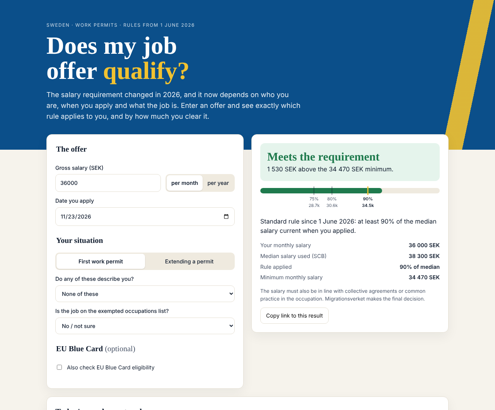

# Does my job offer qualify? 🇸🇪

**A free tool that tells international job seekers in Sweden, in seconds, whether a job offer meets the work permit salary requirement, and which rule applies to them.**

🔗 **Live:** https://sarimyawaredu-crypto.github.io/sweden_work_permit_check/

[](https://github.com/sarimyawaredu-crypto/sweden_work_permit_check/actions/workflows/test.yml)



## The problem

On 1 June 2026 Sweden replaced its work permit salary rule. The minimum went from 80% to 90% of the national median salary, with exemptions at 75% for certain occupations and groups, a six month transition period for extensions, and a separate threshold for the EU Blue Card.

The result is that **the answer to "is this offer enough?" now depends on five things**: the salary, the date you apply (the median changes every June), whether it's a first permit or an extension, whether the job is on the exempted list, and whether you belong to an exempt group.

I'm a non EU master's student in Stockholm looking for my first job here. Every time I looked at a posting I had to piece this together from several Migrationsverket pages, so I built the tool I wanted.

## What it does

* **Picks the right rule automatically**: standard 90%, exempt 75%, transitional 80%, based on your situation and application date.
* **Shows the margin**, not just yes or no: "1 530 SEK above the minimum" or "you need 2 400 SEK more".
* **Highlights an exemption many students miss**: former students applying from within Sweden only need **75%** of the median (28 725 SEK today instead of 34 470 SEK).
* **Checks EU Blue Card eligibility**: salary threshold, qualification and contract length.
* **Uses the right median for the date**: applications before 16 June 2026 are measured against the old median.
* **Shareable results**: every result has a link, useful when discussing an offer with a recruiter.
* Accepts monthly or annual salary.

## Current numbers (verified 23 November 2026)

| Who | Rule | Minimum per month |
|---|---|---|
| Most first time applicants | 90% of median | **34 470 SEK** |
| Exempted occupations, former students applying in Sweden, young tech and life science startups, and two other groups | 75% of median | **28 725 SEK** |
| Extending a permit granted before 1 June 2026, applied for by 1 December 2026 | 80% of median | **30 640 SEK** |
| EU Blue Card | 1.25 × average gross salary | **53 625 SEK** |

Median salary (SCB): 38 300 SEK, current since 16 June 2026.

## How it's built

```
rules.js        the rules engine: dated parameter tables + one pure assess() function
app.js          UI: reads the form, renders the verdict, meter and reference table
index.html      single page, no framework, no build step, no tracking
tests/          node:test suite pinned to the figures Migrationsverket publishes
```

**Design decisions**

1. **Rules as dated data, not hard coded numbers.** Medians and Blue Card thresholds are tables with an effective date. When SCB publishes a new median next June, updating the tool is one line plus one test.
2. **Tests pinned to official figures.** The suite asserts that the engine reproduces the exact amounts Migrationsverket quotes (34 470, 30 640, 29 680 SEK). If a rule change breaks that, CI fails.
3. **Edge dates tested explicitly**: the median switch on 16 June, the category exemptions from 11 June, and the last transitional day, 1 December 2026.
4. **No backend, no data collection.** Salaries never leave the browser. That matters when people are checking their own pay.
5. **Honest limits in the UI**: the tool always reminds users that salary must also match collective agreements, and that Migrationsverket decides.

## Run locally

```bash
python3 -m http.server   # then open http://localhost:8000
npm test                 # runs the rules test suite (Node 18+)
```

## Sources

All rules come from Migrationsverket:

* [Salary requirements for a work permit](https://www.migrationsverket.se/en/word-explanations/salary-requirements-for-a-work-permit.html)
* [New median salary affects the salary requirement](https://www.migrationsverket.se/nyheter/news-archive/2026-06-16-new-median-salary-affects-the-salary-requirement-for-work-permits.html)
* [Exempted occupations and groups](https://www.migrationsverket.se/en/news-archive/news/2026-05-25-new-rules-for-labour-immigration---these-occupations-are-exempted.html)
* [Transitional maintenance requirement](https://www.migrationsverket.se/en/word-explanations/a-good-living---maintenance-requirement-for-work-permits.html)
* [EU Blue Card](https://migrationsverket.se/English/Private-individuals/Working-in-Sweden/Employed/Special-rules-for-certain-occupations-and-citizens-of-certain-countries/EU-blue-card.html)

## Disclaimer

This is not legal advice. Rules change, and Migrationsverket makes every decision case by case. Always confirm on [migrationsverket.se](https://www.migrationsverket.se) before accepting an offer.

## Roadmap

* Swedish language version
* Hourly wage input with a full time equivalent conversion
* Automatic reminder in June when the new median is due

Built by [Sarim Yawar](https://github.com/sarimyawaredu-crypto) · MIT licence
